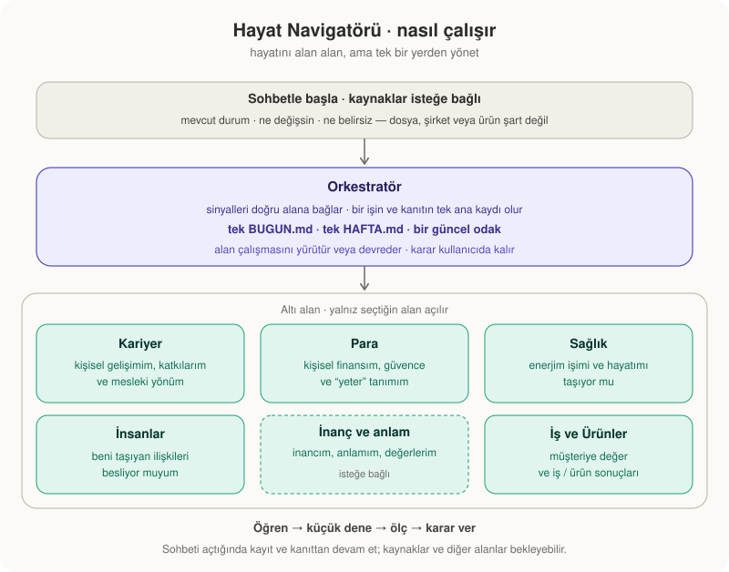

# Hayat Navigatörü

**Hayatını bir ürün gibi yönet: alan alan, ama tek bir yerden.** Bir AI ajanıyla (Claude Code, Codex ya da `AGENTS.md` okuyan herhangi bir ajan) çalışan orkestratör ve altındaki alan navigatörleri.



## Nasıl çalışır

- **Alanlar:** Kariyer, Para, Sağlık, İnsanlar. Her biri kendi klasörü, kendi kuralları ve kendi günlük dosyasıyla çalışır; hepsi aynı kalıbı kullanır: kim / ne / nereye → plan → günlük döngü.
- **Orkestratör:** hayatından gelen sinyalleri (mesaj, takvim, iş, sohbet, sesli not) doğru alana götürür, alanlar arasındaki bağı tutar, bu hafta neyin öncelikli olduğunu söyler ve her sabah **tek bir BUGUN.md** yazar.
- **Sınır:** orkestratör alanın içine girmez, senin yerine karar vermez, hiçbir hesaba yazmaz, para harcamaz.

## Budur, bu değildir

| Budur | Bu değildir |
|---|---|
| Hayatın alanlarını tek yerden görmek | Hayat koçluğu, terapi, motivasyon |
| Sinyalleri toplayıp doğru yere koymak | Mesajlarına senin adına cevap vermek |
| Alanlar arası bağı göstermek (iş → para → ev) | Tıbbi, finansal, hukuki tavsiye |
| Her sabah tek dosya | Seni takip eden bir uygulama |

## Nasıl kullanılır

1. Boş bir klasör aç; `AGENTS.md` ve `CLAUDE.md` dosyalarını içine kopyala.
2. Ajanı başlat. İlk soru: "Hangi alandan başlayalım?" Birini seç; diğerleri boş kalır, istediğinde açılır.
3. Ajan o alan için kaynaklarını ister, sorular sorar, klasörü kurar. Sonra orkestratörü açar.
4. Her sabah `BUGUN.md`. Akşam "bitti".

Kariyer alanının hazır yöntemi: [kariyer-navigatoru](https://github.com/sdogukan/kariyer-navigatoru).

## İlkeler

Yalan yok, şişirme yok · önce plan, açık "yap" ile eylem · kişinin katkısı AI'ınkinden ayrı · önce diyagram · günde tek küçük iş · özel hayat ayrıntısı dosyaya girmez, yalnız alanın ihtiyacı kadar · uzman gereken yerde "uzmana git".

## Klasör yapısı

```
hayat/
├── overview.md · HARITA.md · BUGUN.md · HAFTA.md · gunluk.md
├── sinyaller/                      # kaynaklardan gelen, alana yönlendirilen tarihli notlar
├── kariyer/   para/   saglik/   insanlar/
    (her biri kendi overview.md, TAKVIM.md ve 00–05 klasörleriyle)
```

## Köken

Bir kurucu ortağın "hayatımı da şirketim gibi, bir orkestratörle yönetmek istiyorum" sözünden doğdu; Kariyer Navigatörü'nün üstüne kuruldu. Kişisel veri içermez; yalnız yöntemi paylaşır.

MIT lisansı.
